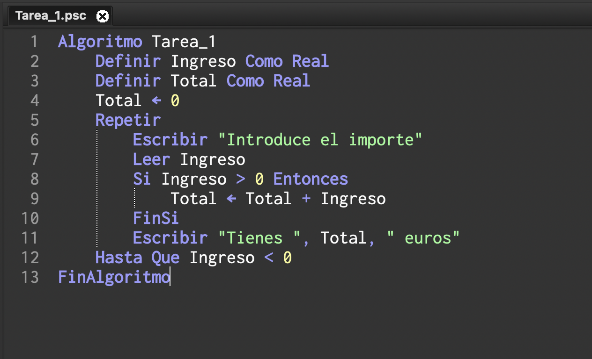
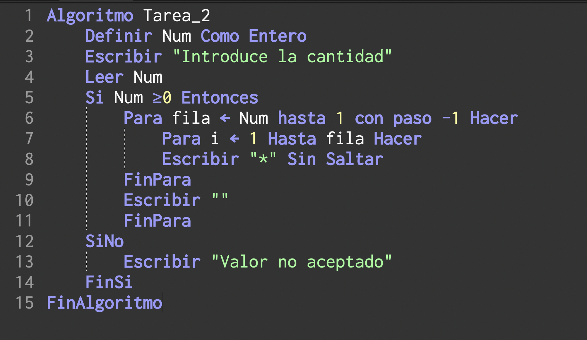

# Pseudocódigo en PSeInt

Dos algoritmos escritos en [PSeInt](https://pseint.sourceforge.net/).

## `suma_importes.psc` · Suma de una secuencia de números
Funciona como una caja registradora: lee importes hasta que se introduce un número negativo y va mostrando el total acumulado.
- `Repetir … Hasta Que`, porque no se sabe cuántos importes habrá.
- `Si … Entonces` para que el número negativo no entre en la suma.
- Acumulador `Total <- Total + Ingreso`, con variables de tipo `Real` para admitir céntimos.

| Entrada | ¿Se suma? | Total |
|---|---|---|
| 1.20 | Sí | 1.20 |
| 3 | Sí | 4.20 |
| -1 | No (fin) | 4.20 |



## `escalera_asteriscos.psc` · Escalera invertida
Pide un número N y dibuja una escalera de asteriscos que empieza con N y baja hasta 1. Si el número es negativo, muestra «Valor no aceptado».
- Dos bucles `Para` anidados: el de fuera recorre las filas de N a 1 (`con paso -1`) y el de dentro escribe los asteriscos de cada fila.
- `Escribir … Sin Saltar` para escribir en la misma línea.

```
****
***
**
*
```


