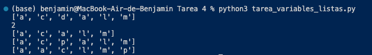

# Listas en Python

Script que trabaja con los métodos básicos de las listas de Python.

| Paso | Código | Resultado |
|---|---|---|
| Crear la lista | `lista1 = ["a", "c", "d", "a", "l", "m"]` | `['a', 'c', 'd', 'a', 'l', 'm']` |
| Contar las `a` | `lista1.count("a")` | `2` |
| Eliminar la `d` | `lista1.remove("d")` | `['a', 'c', 'a', 'l', 'm']` |
| Insertar `p` en la posición 2 | `lista1.insert(2, "p")` | `['a', 'c', 'p', 'a', 'l', 'm']` |
| Ordenar | `lista1.sort()` | `['a', 'a', 'c', 'l', 'm', 'p']` |

## Ejecución
```bash
python3 variables_listas.py
```


