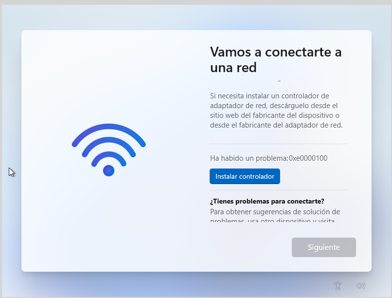
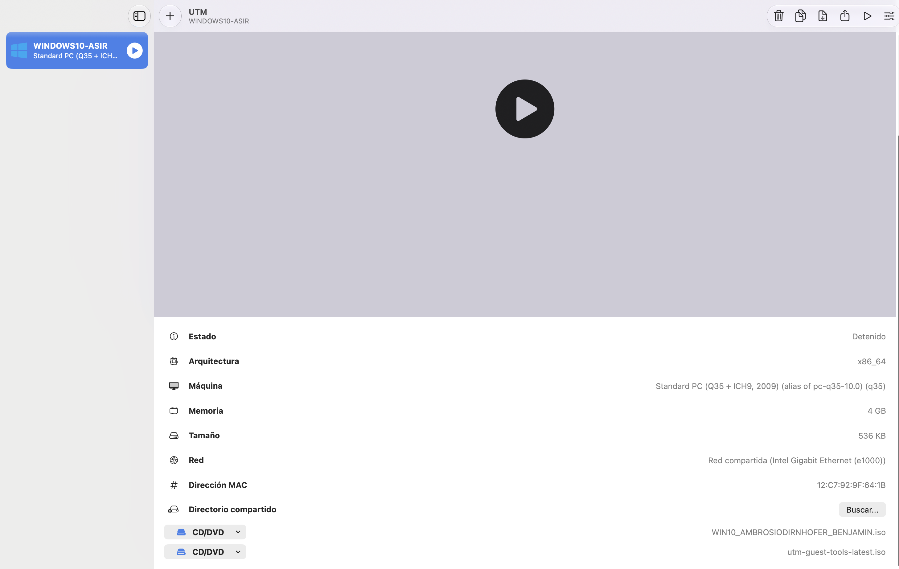
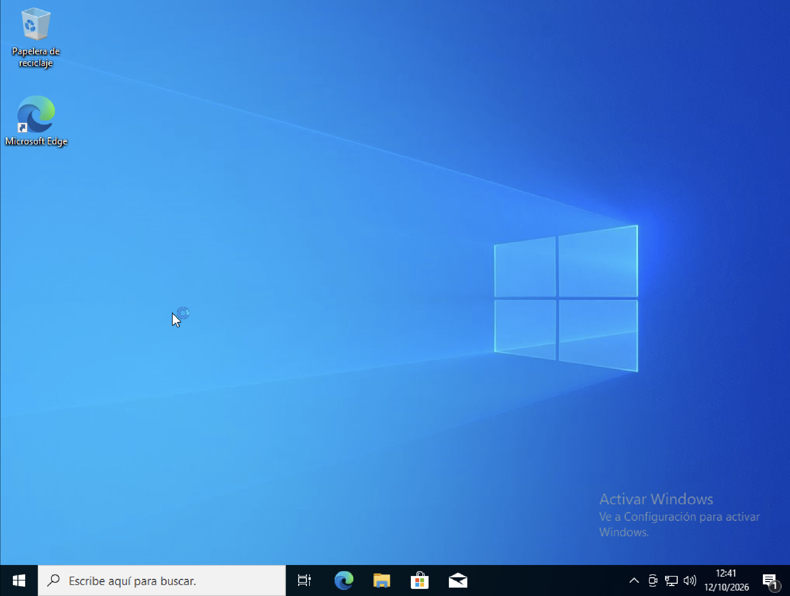
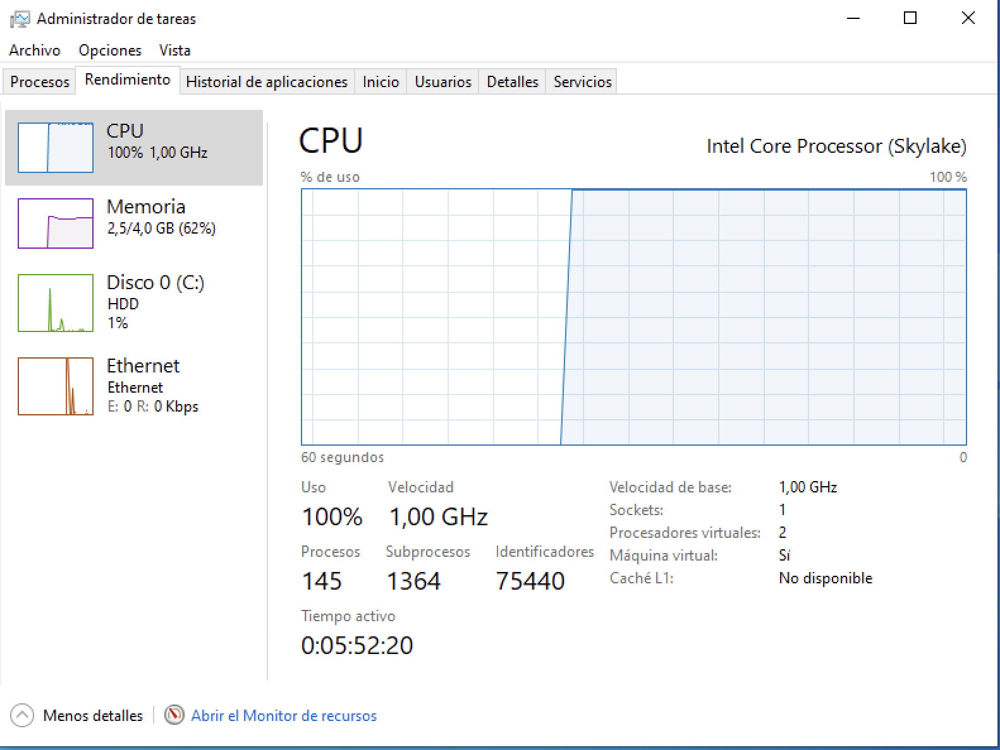

# Windows 10 en una máquina virtual (Mac con Apple Silicon)

Instalación de Windows 10 Pro de 64 bits en una máquina virtual y comprobación de los recursos que se le asignan.

## El reto: ARM frente a x64
El equipo anfitrión es un **MacBook Air con chip Apple M2** (arquitectura ARM, 8 GB de RAM), y la ISO de Windows 10 es **x64**. Como no se puede virtualizar de forma nativa, se usó **UTM en modo Emular** (QEMU).

En un primer intento con VirtualBox, el asistente de configuración de Windows no encontraba el controlador de red (error `0xe0000100`):

## Configuración de la máquina virtual
| Recurso | Valor | Motivo |
|---|---|---|
| Modo | Emular | La ISO es x64 y el Mac es ARM |
| RAM | 4096 MiB | La mitad de la memoria del anfitrión |
| CPU | 2 núcleos | |
| Disco | 40 GiB, formato QCOW2 (reserva dinámica) | Por encima de los 32 GB mínimos de Windows 10 |
| Extras | Controladores y herramientas SPICE | Integración con el anfitrión |

## Instalación
1. Instalador desde la ISO: idioma, formato de hora y teclado en español.
2. Edición **Windows 10 Pro**, sin clave de producto.
3. Disco de 40 GB como destino. Es una máquina emulada, así que la copia de archivos es lenta.
4. Configuración inicial: región, teclado, cuenta de usuario y privacidad.

## Verificación de recursos
En el Administrador de tareas (pestaña Rendimiento) se comprueba que Windows ve lo que se configuró en UTM: **4,0 GB de RAM y 2 procesadores virtuales**. La CPU que aparece («Intel Core Processor») es la que emula QEMU, no la del Mac.

## Lo aprendido
- Un sistema x64 en un anfitrión ARM necesita emulación (más lenta), no virtualización.
- UTM usa discos QCOW2 en lugar de VDI y no ofrece instalación desatendida.
