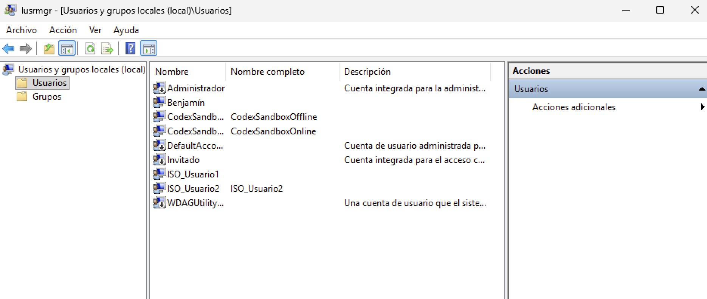
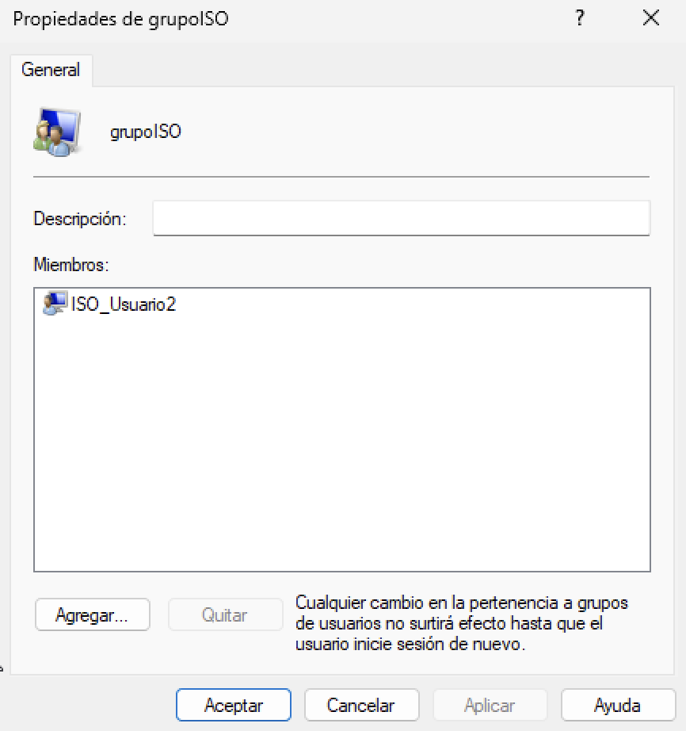
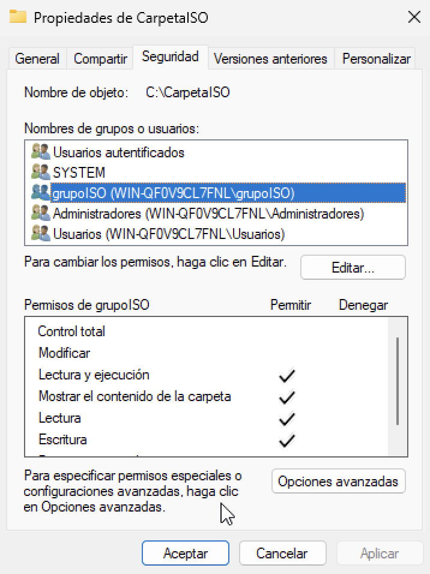
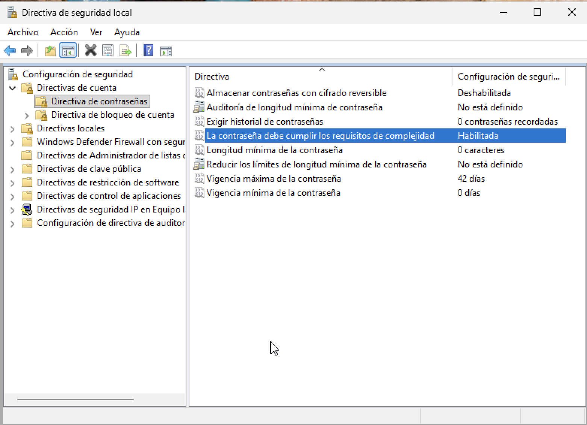
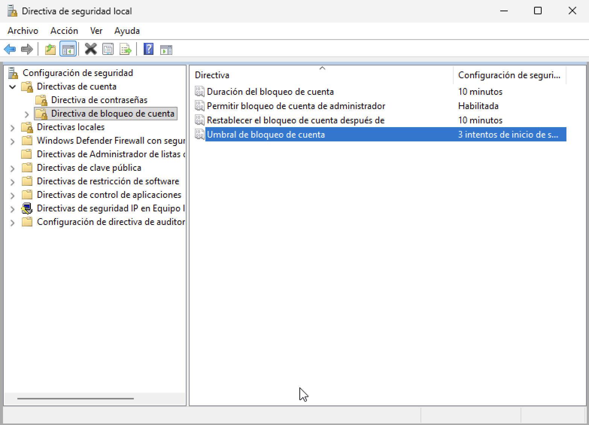

# Usuarios, grupos, permisos y directivas de seguridad en Windows

Práctica de administración local en Windows: crear cuentas y un grupo, dar permisos sobre una carpeta y endurecer las directivas de contraseña y de bloqueo de cuenta.

## 1. Cuentas locales
- **ISO_Usuario1:** cuenta local sin cuenta Microsoft, creada desde *Configuración > Cuentas > Otros usuarios*. Se cambió primero a Administrador y después, desde el Panel de control, a Usuario estándar.
- **ISO_Usuario2:** creado desde **`lusrmgr.msc`** (Usuarios y grupos locales), con la opción de cambiar la contraseña obligatoriamente en el siguiente inicio de sesión.

## 2. Grupo local
Se crea **grupoISO** en `lusrmgr.msc` y se añade como miembro a ISO_Usuario2.

## 3. Permisos NTFS sobre una carpeta
En la pestaña *Seguridad* de `C:\CarpetaISO` se agrega grupoISO y se le permiten **lectura y escritura**.

## 4. Directivas de seguridad local (`secpol.msc`)
| Directiva | Valor |
|---|---|
| La contraseña debe cumplir los requisitos de complejidad | Habilitada |
| Umbral de bloqueo de cuenta | 3 intentos no válidos |
| Duración del bloqueo y restablecimiento del contador | 10 minutos (valor sugerido por Windows) |

En la carpeta [`capturas`](capturas) está el proceso completo paso a paso.
