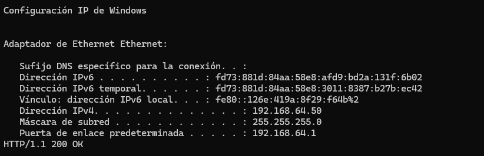
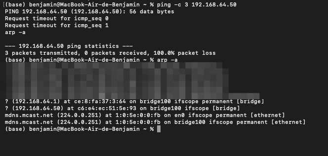
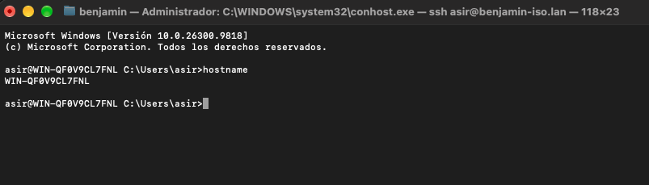
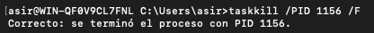

# Configuración y administración remota de un Windows virtualizado

Configurar la red de una máquina virtual Windows, optimizar el sistema y administrarla desde el equipo anfitrión por SSH.

**Entorno:** máquina virtual Windows en UTM sobre macOS. La red está en modo *Red compartida* (subred `192.168.64.0/24`, con el anfitrión como puerta de enlace en `192.168.64.1`).

## 1. IP fija
En `ncpa.cpl` > TCP/IPv4 se cambia la configuración automática por una fija:

| Parámetro | Valor |
|---|---|
| IP | `192.168.64.50` |
| Máscara | `255.255.255.0` |
| Puerta de enlace | `192.168.64.1` |
| DNS | `192.168.64.1`, `8.8.8.8` |

Se comprueba con `ipconfig`. Como el ping (ICMP) está bloqueado en esta red, la salida a Internet se verifica con `curl` (respuesta `HTTP/1.1 200 OK`).



## 2. Nombre de dominio en el archivo hosts
Se añade a `C:\Windows\System32\drivers\etc\hosts` (y a `/etc/hosts` en el Mac):
```
192.168.64.50    benjamin-iso.lan
```

## 3. Optimización del sistema
- **Servicios deshabilitados y detenidos** (`services.msc`): Windows Search (`WSearch`), Xbox Accessory Management (`XboxGipSvc`) y Microsoft Edge Update (`edgeupdate`).
- **Aplicaciones de inicio deshabilitadas:** Microsoft Teams, OneDrive y Terminal. Se mantiene el icono de Seguridad de Windows.
- **Efectos visuales** (`sysdm.cpl`): *Ajustar para obtener el mejor rendimiento*.

## 4. Identificar la máquina virtual desde el anfitrión
Primero un `ping` para que el anfitrión resuelva la dirección física y después `arp -a`. La IP `192.168.64.50` aparece en la interfaz `bridge100` con la misma MAC que tiene la máquina virtual.



## 5. Conexión por SSH
Preparar el servidor OpenSSH en Windows (PowerShell como administrador):
```powershell
Add-WindowsCapability -Online -Name OpenSSH.Server~~~~0.0.1.0
Start-Service sshd
Set-Service -Name sshd -StartupType Automatic
New-NetFirewallRule -Name sshd-puerto22 -Direction Inbound -Protocol TCP -LocalPort 22 -Action Allow
```
El cliente SSH de macOS no admite nombres de usuario con tilde, así que se crea un administrador local `asir` para conectarse:
```bash
ssh asir@benjamin-iso.lan
```



## 6. Gestión de procesos en remoto
```cmd
tasklist
tasklist | findstr /i notepad
taskkill /PID 1156 /F
```
`/F` fuerza el cierre. El Bloc de notas desaparece de la máquina virtual.


